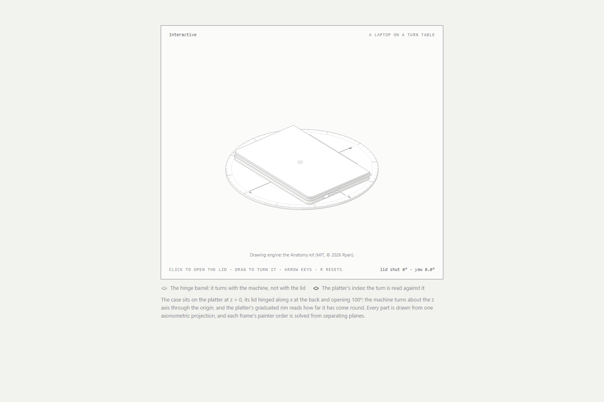
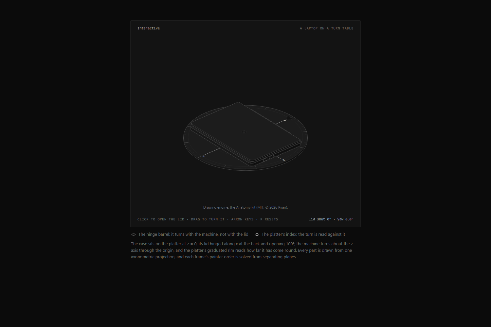

# laptop-3d

An interactive isometric drawing of a laptop on a graduated platter, as one
self-contained HTML file. Click the machine and the lid swings open 100°; drag
around it and the whole machine turns about the vertical axis, with the
platter's graduated rim reading the angle back at you. Arrow keys step the
turn, `R` resets. There is a dark file and a light file; they are the same
drawing and neither is the default.

State: finished. I am not planning further work beyond fixes.

Double-click `dist/laptop-light.html` or `dist/laptop-dark.html` to open it.
It runs straight from `file://` — no server, no `npm install`, no build step
and no network request. To put it in a page of your own, copy the one file and
point an `<iframe>` at it; `embed-example.html` is a working example.

The drawing engine is the Anatomy kit by Ryan (@wheresryan22), MIT-licensed and
embedded in each page. The laptop's geometry and its controls are mine.

### Light



### Dark



Both were captured from the shipped pages, at rest, in headless Edge at
1500 x 1000. Two states still want a shot taken by hand — the lid swung open
and the platter turned to a non-zero angle, with the readout to match — because
both need a real click or drag to reach. `docs/screenshots/README.md` says what
each one has to show.

## What you can do

| Input | What happens |
|---|---|
| Click the machine | The lid swings open 100°; click again and it shuts. |
| Drag in a circle around it | The machine turns about the vertical (z) axis. The platter's graduated rim reads the turn. |
| `←` / `→` | Steps the turn 5°; hold `Shift` for 30°. |
| `Enter` / `Space` | Opens or shuts the lid, the same as a click. |
| `R` | Shuts the lid and returns the turn to 0°. |

The readout under the plate reads `lid shut 0° · yaw 0.0°` and updates as you
turn. On a touch screen, a drag turns it and a tap toggles the lid.

## Open it

`dist/laptop-light.html` and `dist/laptop-dark.html` are the two builds.
Double-click either one. Each is standalone: it carries its own styles, its own
geometry and its own script inline, and needs nothing else in this repo. They
are interchangeable — pick the one that matches the page you are putting it on.
Serving them over HTTP changes nothing.

## Embed it

```html
<iframe src="./laptop-dark.html" title="A laptop on a turn table — an interactive isometric figure"
        loading="lazy" style="border:0;width:420px;height:760px"></iframe>
```

Measured sizing, in Chrome: at 420 px wide the stage renders 349 px wide with
nothing clipped, and the frame stays interactive. The plate's own height is about
1050 px, so give the frame that height if you want no inner scrollbar; otherwise
`loading="lazy"` is fine and the frame scrolls. `embed-example.html` is a working
page with this snippet in it.

## What it needs

The page is a drawing, not a form. The features it uses and the earliest version
of each:

| Feature | What it is for | Needs at least |
|---|---|---|
| `color-mix()` | Derives the four shading tones from two base colours | Chrome/Edge 111, Firefox 113, Safari 16.2 |
| CSS custom properties | The `--anatomy-*` token set and the two themes | Chrome 49, Firefox 31, Safari 9.1 |
| ES modules | The page's own script, inlined as `<script type="module">` | Chrome 61, Firefox 60, Safari 11 |
| Pointer events | Drag to turn, tap to toggle | Chrome 55, Firefox 59, Safari 13 |
| `IntersectionObserver` | Runs the animation only while the figure is on screen | Chrome 51, Firefox 55, Safari 12.1 |

`color-mix()` is the binding constraint. There is no polyfill and no fallback:
before those versions the four tones collapse to one flat colour, so the drawing
looks unfinished rather than failing with a message.

It runs from `file://` because the whole script is inlined into the page. There
is no `import` statement anywhere in it — zero — so there is no module fetch for
the browser's CORS rule to block, and a local file behaves exactly as a served
one.

## What is in the drawing

| Number | Value | Where it comes from |
|---|---|---|
| Solid parts | 83 | `node src/build.mjs` prints `83 parts · base 76 · lid 7` |
| Base parts | 76 | the same build line |
| Lid parts | 7 | the same build line |
| Page size | 456 KB | the same build line; `dist/laptop-dark.html` is 466 871 bytes on disk |
| Network requests | 0 | the page contains no external URL except the SVG XML namespace, which is not fetched |
| Runtime dependencies | 0 | no npm package, no vendored library, no CDN script, no webfont |
| Build time | 0.6–0.7 s | the build's own timer, one run |

## How it was built

I built this figure with the `anatomy` skill — the turning engine in the Anatomy
kit (`kit/turn-build.mjs`, `kit/turn.mjs`, `kit/lathe.mjs`, `kit/iso-kit.mjs`)
and the `--anatomy-*` token set from `kit/iso.css`. The kit supplied the
axonometric projection, the solid primitives, the painter's-order solver, the
plate chrome and the two themes. I wrote the laptop's dimensions and its parts
in `src/build.mjs`, and the interaction harness in `src/live.js`.

The citation is checkable three ways in this repo, which is why it is the only
one I make:

- `src/build.mjs` says so in its header — `Built with the anatomy kit's turning
  engine (skill: creative/anatomy, references/3d.md)`.
- Both pages carry the kit's `--anatomy-*` custom properties verbatim.
- Both pages print a credit line under the figure: `Drawing engine: the Anatomy
  kit (MIT, © 2026 Ryan).`

Built against the Anatomy kit as of 2026-10-28. No version is pinned, so a newer
kit may produce different output; see `docs/owner-todos.md`.

I also originally expected to cite `diagram-design` and `web-design-recipes`.
I found no evidence of either in the kit or the built pages, so I left them out.
If either was used, it can be added once there is something to point at.

## Rebuild it

You need a checkout of the Anatomy kit to rebuild. From the repo root:

```sh
ANATOMY_KIT=/path/to/anatomy node src/build.mjs          # writes dist/laptop-light.html
ANATOMY_KIT=/path/to/anatomy node src/build.mjs --dark   # writes dist/laptop-dark.html
```

Node 20.10 or newer. `--audit` runs the geometry and clearance checks first. The
output will not be byte-identical to the committed pages unless you have the same
kit snapshot, because nothing pins the kit's version.

## Checks I ran

Every result below came from Chrome on one Windows machine; none of it is a
cross-browser or cross-device result.

| What | How | Result |
|---|---|---|
| Phone width, 390 px | measured scroll width and the stage's box | no horizontal overflow (scroll width 390 = viewport 390); stage fully visible, 334 px wide |
| Touch drag turns it | a simulated touch drag across the stage | the readout went from `yaw 0.0°` to `yaw 341.9°`; the page did not scroll |
| Still at rest | three readouts sampled with no input | `lid shut 0° · yaw 0.0°` three times; nothing moves on its own |
| `prefers-reduced-motion: reduce` | emulated the media feature, then sampled | still throughout; nothing animates |
| JavaScript exceptions | the console for the whole run | 0 |
| Embed, eager and lazy | `node tools/embed-check.mjs <url>`, against Chrome on `--remote-debugging-port=9222` | frame loaded and rendered (327 colours, 14 % ink); a drag inside it changed 1.1 % of the frame — in both the eager and the lazy case |
| Frames per second | Chrome, CPU throttled 4×, at rest | 60.9 fps — one machine, one run, a sanity check and not a benchmark |

`tools/embed-check.mjs` needs Chrome already running with
`--remote-debugging-port=9222`; it reads the frame over the DevTools protocol. It
uses Node's global `WebSocket`, which is unflagged from Node 22.

## Accessibility

The stage is `role="slider"` with `aria-valuenow` and `aria-valuetext`, and the
harness keeps both in step with the turn (`laptop shut, turned 0 degrees`). It is
keyboard-operable: `Tab` reaches it, `Enter` or `Space` toggles the lid, `←`/`→`
step the turn, `R` resets. Nothing animates unless you ask it to, and
`prefers-reduced-motion: reduce` is honoured.

Known gap: this is a figure, not a form control, and it has had no screen-reader
testing. The slider role is a reasonable fit for "turn this and a number changes",
but I have not confirmed how it is announced.

## What works and what does not

Works: both themes open, render and respond; click, drag and the keyboard; the
embed in an iframe; the whole thing offline from `file://`.

Not done: the open-lid and turned-platter screenshots are still missing, because
both states need a real click or drag (`docs/screenshots/README.md`); the
page cannot be rebuilt without the Anatomy kit; the kit's version is not pinned,
so a rebuild is not reproducible; nothing has been tested outside Chrome.

## Licence and credit

My work — the laptop's geometry in `src/build.mjs`, the controls in `src/live.js`,
the build script and the check script — is MIT, Copyright (c) 2026 Chen Bin, in
`LICENSE`.

The embedded drawing engine is the Anatomy kit by Ryan (@wheresryan22),
https://github.com/wheresryan22/anatomy, also MIT, Copyright (c) 2026 Ryan. Its
notice is kept in `THIRD-PARTY-NOTICES.md` and inside each built page in `dist/`.
If you redistribute a built page, keep both notices.

## Limits

- Not a 3D engine. It draws one fixed axonometric projection; there is no camera
  to move and no shading to light.
- Not a model you can load elsewhere. There is no glTF, no OBJ and no mesh — the
  geometry is solved at build time into SVG paths.
- Not parametric at runtime. The dimensions are constants in `src/build.mjs`.
  Changing them means rebuilding with the Anatomy kit.
- One laptop. No other machine, no size or detail options.
- No pinch-zoom on touch. It turns; it does not scale.

## Credits

- **`anatomy`** — the Hermes/Claude skill for isometric SVG illustration
  (`creative/anatomy`). Its turning engine and `--anatomy-*` tokens are in both
  pages; the fingerprint is the header comment in `src/build.mjs`, the
  `--anatomy-*` custom properties, and the on-page credit line.
- **Anatomy kit** by Ryan (@wheresryan22) —
  https://github.com/wheresryan22/anatomy — MIT. Full licence in
  `THIRD-PARTY-NOTICES.md`.

Cited here and nowhere else: `diagram-design` and `web-design-recipes` are left
out for lack of evidence. See `CREDITS.md` and `docs/owner-todos.md`.
